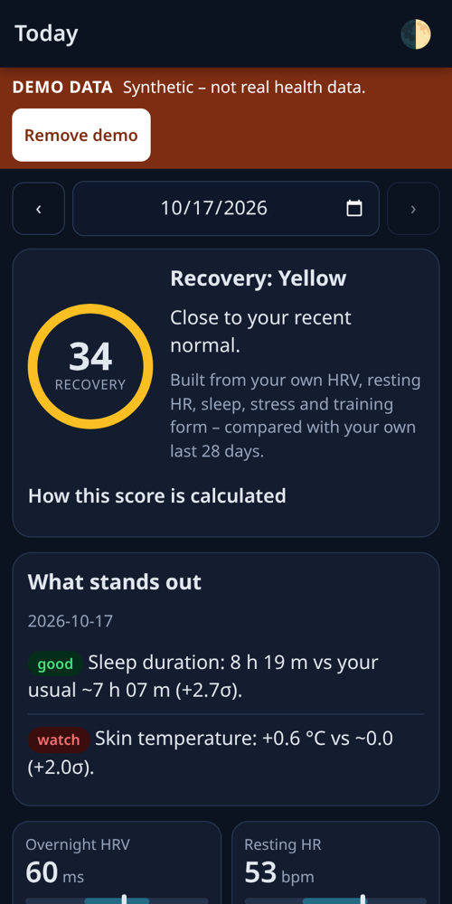
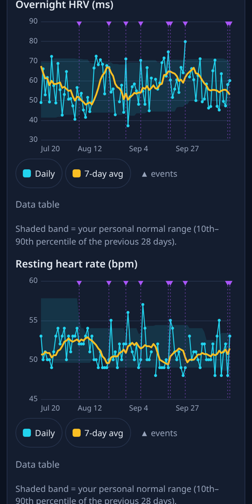
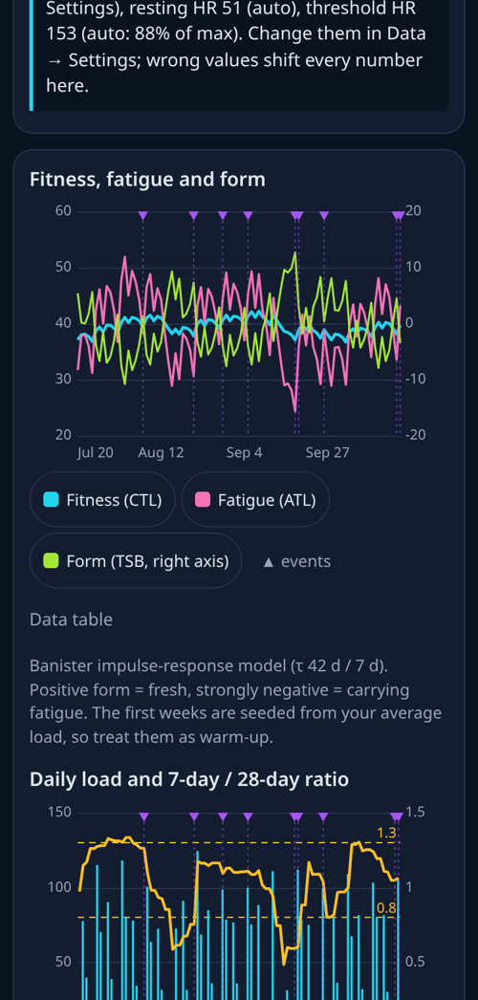
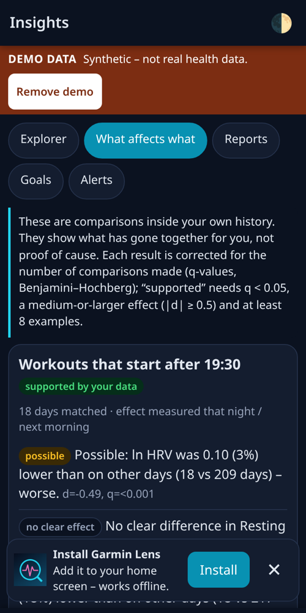

# Garmin Lens

**Private, offline-capable charts and deeper insights from your own Garmin data.** Import your Garmin "Export Your Data" ZIP (or individual FIT / TCX / GPX / CSV / JSON files) and get recovery, HRV and resting-HR baselines, sleep consistency, training load, correlations and plain-English findings, all computed **in your browser**. No server, no account, no tracking, no Garmin password.

**Live app:** <https://theriotcoder.github.io/garmin-lens/> (installable PWA, works offline after the first load)

> **Demo data.** With no Garmin export loaded the app can generate clearly-labelled **synthetic demo data** so you can look around. Demo screens always show a "DEMO DATA" bar. The screenshots below are demo data, not anyone's health.
>
> **Not medical advice.** Garmin Lens describes patterns in your own data. It is not a medical device and cannot diagnose, treat or prevent anything. Wrist sensors are imperfect. Talk to a clinician about health concerns. Not affiliated with or endorsed by Garmin; "Garmin" and "Connect" are trademarks of Garmin Ltd.

| Today | Trends | Training | What affects what |
|---|---|---|---|
|  |  |  |  |

## What it adds beyond Garmin Connect

- **Baselines you can see:** 7/30/90-day averages, your personal normal range (shaded) and a z-score for every metric, always versus *your* previous 28 days.
- **Recovery score with the formula on screen:** HRV, resting HR, sleep, prior-day stress and training form, with per-signal contributions. (Not Garmin's Training Readiness, which is shown separately if your export has it.)
- **Sleep:** consistency (bedtime/wake SD), social jet lag (MCTQ), sleep debt, stage charts, weekday-vs-weekend.
- **Training:** TRIMP/hrTSS from heart rate, Banister fitness/fatigue/form (CTL/ATL/TSB), rolling load ratio, monotony and strain, weekly zone distribution, best efforts, VO2max trend.
- **Activity analytics:** aerobic decoupling (Pa:HR), cardiac drift, zone distribution, best 1 km/1 mi/5 km/10 km efforts, from FIT files.
- **Insights:** a correlation explorer (any two measures, any lag, with sample-size and autocorrelation warnings and "correlation is not causation"), a "what affects what" scan with multiple-testing correction, event hypotheses (late workouts, alcohol/caffeine tags, hard days, stress), illness-like "body strain" signature detection, weekly/monthly reports, goals.
- **Your events on the charts:** tag cycle phase (treated as a confounder), alcohol, late caffeine, travel, illness, races; they show as ▲ markers and become testable hypotheses.
- **Yours to keep:** CSV/JSON export, encrypted backups, one-tap "delete everything".

Every formula is documented in [docs/METHODS.md](docs/METHODS.md) and covered by known-answer tests.

## Import your data

1. On a computer open your Garmin account page → **Manage Your Data → Export Your Data → Request Data Export** (<https://www.garmin.com/en-US/account/datamanagement/>).
2. Garmin emails a download link. **Timing is not guaranteed:** write-ups report minutes to a couple of days; Garmin's own page did not state a time. Re-requesting does not help.
3. Download the ZIP, open Garmin Lens → **Data → Import**, and drop the **whole ZIP** (do not unzip). Hundreds of MB are fine: entries are read lazily and the nested `UploadedFiles_*.zip` archives of FIT files are opened too.
4. Optional extras: single activities from Garmin Connect web (activity page → ⚙ → Export Original / TCX / GPX / CSV) and the Activities-list CSV can be dropped in too.
5. Re-import any time (e.g. monthly). Records merge by date and activity start time and are never duplicated. Importing real data replaces demo data.

Set your **max HR, resting HR, threshold HR and sleep need** under Data → Settings; otherwise they are estimated (labelled "auto" – max HR comes from the ~99th percentile of your own sustained heart rate and the app asks you to confirm it; load numbers are approximate).

## Privacy

- Files are parsed in a Web Worker in your browser. **Nothing is uploaded.** The page ships a strict Content-Security-Policy (`connect-src 'self'`) and the code contains no `fetch`/XHR/WebSocket calls (a test enforces it), so it cannot send your data anywhere. No analytics, no cookies, no third-party scripts or fonts, no CDN.
- Data is kept in your browser's IndexedDB. It is **not encrypted at rest by the app**; rely on device encryption/lock-screen and use the passphrase-encrypted backup (PBKDF2-SHA-256 250 000 rounds + AES-256-GCM, tamper-checked) for copies. Plain JSON/CSV exports are unencrypted.
- The only localStorage entry is your light/dark choice. Data → "Delete all my data" wipes everything.
- GitHub Pages cannot set HTTP headers, so on that host the CSP is delivered by a `<meta>` tag (which cannot carry `frame-ancestors`). `public/_headers` holds the full header set for a Cloudflare-style deploy (a test keeps the two policies identical).

## How can an app get Garmin watch data? (research, 2026-10-17)

| Route | Verdict |
|---|---|
| **Garmin Connect Developer Program (Health / Activity API)** | Enterprise/business use only, needs approval and a server, and developers report (forum, Mar–Aug 2026) that reviews are currently paused. **Not available to an individual.** |
| **Account "Export Your Data" ZIP** (JSON + FIT) | **Works for anyone, no server.** Chosen primary route. Snapshot, so re-export occasionally. |
| **Per-activity export from Garmin Connect** (FIT/TCX/GPX/CSV) | Works, supported as a supplement. |
| **Unofficial API** (`python-garminconnect`, `garth`) | Technically possible with a script on your computer, **fragile** (Garmin changed auth in March 2026; `garth` was deprecated), needs your password, cannot run in a browser, and is not a sanctioned path. Not built in; see [docs/ADVANCED-SYNC.md](docs/ADVANCED-SYNC.md) (untested idea). |
| **Apple Health / Android Health Connect** | Garmin only writes a **subset** (steps, HR, sleep, workouts, weight…) and **not** HRV, resting HR, SpO2, respiration, stress or body battery, which are the point here. Health Connect needs a native app. Not built. |

Full notes, field-name tables and every source: [docs/RESEARCH.md](docs/RESEARCH.md). Key sources:

- Garmin Connect Developer Program FAQ and overview: <https://developer.garmin.com/gc-developer-program/program-faq/> · <https://developer.garmin.com/gc-developer-program/overview/>
- Forum report of paused API approvals: <https://forums.garmin.com/developer/fit-sdk/f/discussion/435484/developer-onboarding-blocked>
- Export Your Data page and FAQ: <https://www.garmin.com/en-US/account/datamanagement/> · <https://support.garmin.com/en-US/?faq=W1TvTPW8JZ6LfJSfK512Q8>
- Export structure/format write-ups and parsers: Runalyze blog on the Garmin export; `radikkhaziev/triathlon-agent`, `tintin305/GarminSleepAnalytics` and other public parsers (full list in RESEARCH.md); `arpanghosh8453/garmin-grafana` issue #189 / PR #191.
- HRV summary format: <https://support.mydatahelps.org/garmin-heart-rate-variability-summary-export-format>
- Unofficial API state: <https://github.com/matin/garth/discussions/222> · <https://github.com/cyberjunky/python-garminconnect/releases/tag/0.3.0>
- Health Connect / Apple Health coverage: <https://www.androidcentral.com/wearables/garmin/heres-everything-garmin-will-and-wont-share-with-google-health-connect> · <https://support.garmin.ru/support/solutions/articles/26000046832>
- FIT protocol and real-file ground truth: Garmin FIT SDK docs; test files from `dtcooper/python-fitparse` (MIT).

## What is verified, and what is not

**No real Garmin export was available while building this.** Everything below the line "verified" was checked against public sources or real files, never against Derriel's own account.

| Item | Status |
|---|---|
| FIT parser (headers, compressed timestamps, developer fields, scale/offset, CRC, chained files) | **Verified** against 6 real Garmin FIT files and python-fitparse output (10 686 + 754 record-level matches) |
| `summarizedActivities` shape and units (ms, cm, float epochs) | Verified against real records published in public repos |
| `UDSFile` daily fields, `sleepData` fields | Verified against public parsers and issue-pasted records; two date shapes handled |
| `healthStatusData` (overnight HRV etc.) | **Partly verified**: one public parser + one blog; no real record seen |
| Training readiness / acute load / `ActivityVo2Max` / bio-metrics | One public source each |
| `hrTimeInZone_*` units, sleep SpO2 object names, nested respiration object, `MetricsMaxMet` VO2max meaning | **Unverified**, parsed defensively |
| Activities-list CSV headers/distance unit | **Unverified** (English headers matched loosely; unit selectable) |
| Export turnaround time | Reported by third parties, not by Garmin |
| Tested only in headless Chrome 155 (320/375/412 px) and Node 20; not on Safari/iOS/Firefox | **Unverified** |
| Performance on multi-GB exports | **Unverified** (streaming design, tested on synthetic + small files) |
| Insights/recovery formula usefulness for any individual | **Not clinically validated.** Demo data validates the code paths against planted effects, not physiology. |

The `tests/fixtures/garmin-format/README.md` file says, per fixture, whether it is verbatim-real, partly reconstructed or invented.

## Limitations

- A snapshot app: it only knows what is in the export you give it, and Garmin may change export formats without notice.
- Garmin dates sleep/HRV by the day you wake up, so "same-day" timing is a pre-workout baseline check and recovery shows at +1 day. Wrist sleep stages are only roughly accurate.
- Warnings are "worth watching" (1 night) or "strain pattern" (2+ days), never a diagnosis. Seek care for fever, chest pain, shortness of breath or fainting.
- With several comparisons, one may look significant by chance; treat single hits as leads.
- The importer has **not** been tested against a real Garmin export.
- Garmin's nightly HRV is a single wrist-derived number; there is no beat-to-beat data in the export, so no DFA/real-HRV analysis.
- Heart-rate load is only as good as your max/resting/threshold HR settings and the sensor (optical HR lags and drops out in intervals, cold, tattoos).
- Activities with only an average HR underestimate load; activities without HR are excluded from load.
- Correlations in a few months of one person's data are hints; the app reports effective sample size and corrects for multiple tests, but cannot remove confounding.
- No at-rest app-level encryption of the IndexedDB data (planned: optional passphrase lock).

## Development

```bash
node tests/run-all.js                                   # unit tests (Node 20+): parsers, FIT, ZIP, stats, models, insights, storage, shell
node --experimental-websocket tests/browser-smoke.js    # headless Chrome over CDP at 320/375/412 px (needs google-chrome + python3)
APP_URL=https://theriotcoder.github.io/garmin-lens/ node --experimental-websocket tests/browser-smoke.js   # same checks against the live site (offline phase skipped)
python3 tools/make_icons.py                             # regenerate icons (Pillow)
sh tools/build-site.sh                                  # dist/ for a Cloudflare-style deploy (app + public/_headers)
```

Vanilla JS, no build step, no dependencies, no vendored libraries. Pure modules are UMD, so they run in the page, the import worker and Node. Layout: `js/{dates,stats,zip,fit,parsers,importer}.js` (ingest), `js/{models,insights}.js` (analysis), `js/{charts,ui,app,views,data-view}.js` (UI), `js/{db,crypto,demo}.js`, `sw.js`, `docs/`. Service worker: cache-consistent per `VERSION`, user taps "Update" to switch (bump `VERSION` in `sw.js` and `APP_VERSION` in `js/app.js` together; a test checks they match).

Deployment: GitHub Pages serves the repo root directly (`.nojekyll`). A Cloudflare deploy is possible with `tools/build-site.sh` but is not set up.

## License

MIT. See [LICENSE](LICENSE).
